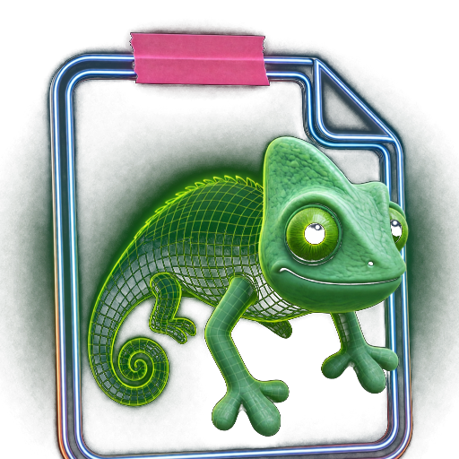

<p align="center">
  
</p>

<h1 align="center">Spacebar 3D</h1>
<p align="center"><strong>Deine Modelle. Nur eine Leertaste entfernt.</strong></p>
<p align="center">Ein nativer 3D-Viewer für Finder Quick Look und deinen Mac.</p>
<p align="center">
  
  
  
  <a href="../../LICENSE"></a>
</p>
<p align="center">
  <a href="#install">Erste Schritte</a> · <a href="#formats">Formate</a> · <a href="#controls">Steuerung</a> · <a href="DEVELOPMENT.md">Entwicklerhandbuch</a>
</p>
<p align="center"><a href="../../README.md">English</a> · <a href="../zh-Hans/README.md">简体中文</a> · <a href="../es/README.md">Español</a> · <a href="../fr/README.md">Français</a> · <strong>Deutsch</strong> · <a href="../ja/README.md">日本語</a> · <a href="../pt-BR/README.md">Português do Brasil</a> · <a href="../ko/README.md">한국어</a> · <a href="../it/README.md">Italiano</a> · <a href="../ru/README.md">Русский</a></p>

---

## Finden. Leertaste. Drehen.

Wähle eine unterstützte 3D-Datei im Finder und drücke die <kbd>Leertaste</kbd>. Drehe das Modell, prüfe seine Topologie, ändere die Darstellung oder gehe eine Animation durch. Öffne es in der App, wenn du ein eigenes Fenster dafür möchtest.

<p align="center">
  
</p>

> macOS verwendet für OBJ, STL, PLY, USD und USDZ möglicherweise seine eigene Vorschau. Über **Ablage → Öffnen…** oder **Öffnen mit → Spacebar 3D** im Finder öffnest du jede unterstützte Datei in diesem Viewer.

<a id="looks"></a>

## Ein Modell, viele Ansichten

| Prüfen | Entdecken | Abspielen |
| :--- | :--- | :--- |
| Ansichten „Vollansicht“, „Texturiert“ und „Normalen“; Drahtgitterüberlagerung; Flächen- und Eckpunktzahlen. | „Unschattiert“, Anime, Cel-Shading, Retro, Voxelkunst und Hologramm; flache oder glatte Schattierung und Materialanpassungen. | Clipauswahl, Zeitleiste und Wiederholung; Skelettvorschau für unterstützte Dateien, die nur Animationen enthalten. |

**Licht gestalten.** Sieben Stimmungen von Glasshouse bis Neon, mit Helligkeit, Richtung und automatisch rotierendem Licht. **Orientierung behalten.** Klicke eine Gizmo-Achse an, drehe, verschiebe oder passe das Modell ein und blende das Bodenraster ein. Kleine Finder-Vorschauen zeigen nur das Modell.

**Nativ für den Mac.** Swift, Metal, SwiftUI und AppKit, gemeinsam genutzt von App und Quick-Look-Erweiterung. Modelle werden lokal verarbeitet; beide Komponenten haben keine Netzwerkberechtigung. Die Oberfläche unterstützt die zehn oben verlinkten Sprachen und folgt den macOS-Spracheinstellungen. [Lokalisierungshinweise auf Englisch](../LOCALIZATION.md).

<a id="install"></a>

## Erste Schritte

**macOS 26 oder neuer · Apple silicon · aus dem Quellcode bauen**

Du brauchst die vollständige Xcode-Installation mit dem macOS-26-SDK oder neuer, XcodeGen, CMake und Ninja. Das Projekt verwendet ein Entwicklungsteam zum Signieren und eine App Group. Wenn du ein anderes Team nutzt, richte deine Signatur und die zusammengehörigen Kennungen vor dem Bauen gemäß der [Signierungsanleitung](DEVELOPMENT.md#build-local) ein.

Im lokalen Checkout:

```bash
brew install xcodegen cmake ninja
./scripts/build.sh
```

Beim ersten Build wird die festgelegte Assimp-Version heruntergeladen und gebaut.

1. Verschiebe `build/Build/Products/Release/Spacebar 3D.app` nach **Programme**.
2. **Starte die App einmal**, damit macOS die Erweiterung registriert.
3. Aktiviere **Spacebar 3D** unter **Systemeinstellungen → Allgemein → Anmeldeobjekte & Erweiterungen → Quick Look**.
4. Wähle eine unterstützte Datei im Finder und drücke die <kbd>Leertaste</kbd>.

Zum Weitergeben eines Builds folge der [Anleitung für Developer-ID-Signierung und Notarisierung](DEVELOPMENT.md#distribution-signing--notarization).

<details>
<summary><strong>Spacebar 3D als Standard-App festlegen</strong></summary>

Klicke in den App-Einstellungen auf **Als Standard festlegen…**. macOS kann eine Bestätigung verlangen; nicht geänderte Formate werden angezeigt. Das betrifft den Doppelklick im Finder, nicht die Auswahl der Quick-Look-Erweiterung.

</details>

<a id="formats"></a>

## Unterstützte Formate

Avatare, Spielressourcen, CAD-Exporte, Scans und Blender-Meshes.

`VRM` · `VRMA` · `glTF` · `GLB` · `FBX` · `OBJ` · `STL` · `3MF` · `PLY` · `USD` · `USDA` · `USDC` · `USDZ` · `3DS` · `BLEND`

<details>
<summary><strong>Unterstützung und Grenzen je Format</strong></summary>

| Format | Unterstützung |
| :--- | :--- |
| `.vrm` | VRM-Avatare 0.x / 1.0: Toon-Shading, Konturen und Spring Bones. |
| `.vrma` | VRM-Animation ohne Mesh; die Bewegung wird mit einer Strichfigur des Skeletts dargestellt. |
| `.glb` / `.gltf` | glTF 2.0 mit Materialien, Texturen, Skinning und Animationen. Externe `.bin`-Dateien und Bilder erfordern Ordnerzugriff. Draco, Meshopt und instanzierte Meshes werden nicht unterstützt. |
| `.fbx` | Binär oder Text; Meshes mit Skinning und eingebettete Animationen. Bilder aus der Datei, daneben oder aus dem zugehörigen `.fbm`-Ordner. |
| `.obj` | Geometrie und Eckpunktfarben; Materialien und Texturen aus `.mtl` nach Ordnerfreigabe. Dateien ohne Flächen erscheinen als Punktwolken. |
| `.stl` | Binäres oder textbasiertes STL. |
| `.3mf` | Farben je Objekt oder Dreieck, Bilder sowie metallische und durchscheinende Materialien. |
| `.ply` | Meshes mit Eckpunktfarben oder Punktwolken, wenn keine Flächen vorhanden sind. |
| `.usd` / `.usda` / `.usdc` / `.usdz` | Materialien, eingebettete Texturen und Skelettanimationen. |
| `.3ds` | Materialfarben und Transparenz; externe Texturen nach Ordnerfreigabe. |
| `.blend` | Blender 2.80 oder neuer: sichtbare Meshes und einfache Materialien im gespeicherten Zustand; gepackte Bilder und Texturen im freigegebenen Ordner. Modifikatoren, Armature-Posen und Animationen werden nicht angewendet; beliebige Shader-Knotennetze werden nicht ausgewertet. |

FBX-Dateien mit ausschließlich Animationen und VRMA-Dateien mit unterstütztem Skelett erscheinen als Strichfiguren. Die App enthält keine Modell- oder Avatardaten.

</details>

### Texturen in separaten Dateien

Mit **Texturen anzeigen…**, **Materialien anzeigen…** oder **Modell anzeigen…** erlaubst du Lesezugriff auf den Modellordner und seine Unterordner. Eingebettete Texturen benötigen keine Ordnerfreigabe, müssen aber unterstützte Bild- und Materialformate verwenden. In der App kann eine gleichnamige Materialdatei wie `ship.mtl` neben `ship.obj` ohne Rückfrage gelesen werden.

Wenn sich das Modell öffnen lässt, aber keine der referenzierten Texturen dargestellt werden kann, wechselt der Viewer von **Texturiert** zu **Vollansicht**.

<a id="controls"></a>

## Die Steuerung

| Aktion | Bedienung |
| :--- | :--- |
| Drehen | Ziehen oder Pfeiltasten bei fokussierter Modellansicht in der App |
| Verschieben | Mit rechter Maustaste ziehen oder beim Ziehen Umschalt, Option oder Befehl halten |
| Mit Tastatur verschieben | Umschalt + Pfeiltasten in der Modellansicht oder das Verschieben-Untermenü unter Darstellung |
| Zoomen | Scrollen oder Pinch-Geste |
| Modell einpassen | Einpassen-Taste oder ⌘0 in der App |
| Entlang einer Achse schauen | Achse im Gizmo anklicken |
| Abspielen oder pausieren | Wiedergabetaste oder Leertaste bei fokussierter Modellansicht in der App |
| Quick Look schließen | Leertaste |
| Einfarbig / Texturiert / Normalen | ⌘1 / ⌘2 / ⌘3 in der App |
| Drahtgitter umschalten | ⌘4 in der App |

Unten liegen Ansichten, Stile und Materialien; rechts Gizmo, Licht, Einpassen, Raster und automatische Drehung. Die Animationsleiste bietet Clipauswahl und Wiederholung. In den Einstellungen legst du Hintergrund, Modellfarbe, Ansicht, Helligkeit, Raster, Drehung und Wiedergabe fest. Die Menüs für Darstellung und Wiedergabe bleiben auch bei ausgeblendeten Bedienelementen verfügbar.

<a id="help"></a>

## Wenn etwas hakt

Öffne das Menü **?** in der Symbolleiste des Viewers. Dort findest du die Bedienhinweise, die Datenschutzerklärung und die Danksagungen. Das Menü ist in der App und in Quick Look verfügbar.

Ein Problem gefunden oder eine Frage? Wähle in der App **Hilfe → Spacebar 3D-Support** oder [eröffne ein Issue](https://github.com/vitalis/Spacebar3D/issues).

<details>
<summary><strong>Die Vorschau erscheint nicht</strong></summary>

Starte die App einmal und aktiviere die Erweiterung. Falls nötig, aktualisiere den Quick-Look-Cache:

```bash
qlmanage -r && qlmanage -r cache
```

Öffne OBJ, STL, PLY, USD oder USDZ versuchsweise direkt in der App.

</details>

<details>
<summary><strong>Spacebar 3D statt Apples Vorschau bevorzugen</strong></summary>

Die optionale Umstellung lässt sich rückgängig machen:

```bash
scripts/prefer-spacebar3d.sh status
scripts/prefer-spacebar3d.sh on
scripts/prefer-spacebar3d.sh off
```

`on` bevorzugt Spacebar 3D; `off` aktiviert Apples Erweiterungen wieder. Das Skript deaktiviert zwei Apple-Erweiterungen für dein Benutzerkonto mit `pluginkit`, ohne Systemdateien zu ändern. MaterialX und Alembic erhalten eine einfachere Vorschau, USDZ verliert die AR-Ansicht und `.reality` hat keine Vorschau. Ein macOS-Update kann die Auswahl zurücksetzen. Das direkte Öffnen in der App benötigt diese Umstellung nicht.

</details>

<details>
<summary><strong>Texturen fehlen</strong></summary>

Gib den Ordner mit **Texturen anzeigen…** frei. Eine nur in Quick Look erteilte Freigabe muss nach einem Mac-Neustart erneut erfolgen. Die App merkt sich ihre Freigaben; ein Start nach dem Neustart macht sie wieder für Quick Look verfügbar. Fehlende Bilder und nicht unterstützte Bild- oder Materialformate können die Anzeige einer Textur verhindern.

</details>

<a id="architecture"></a>

## Unter der Haube

App und Erweiterung teilen sich `Spacebar3DKit`: `ImportRouter` liest die Datei in eine `ModelScene`, Metal zeichnet sie. Swift-Reader verarbeiten STL, PLY, OBJ, 3MF, glTF, VRM und Blender; Model I/O verarbeitet USD, Assimp FBX und 3DS.

[Build und Architektur](DEVELOPMENT.md) · [Lokalisierung](../LOCALIZATION.md) · [Änderungsprotokoll](../../CHANGELOG.md) · [Datenschutzerklärung auf Englisch](../../PRIVACY.md)

<a id="credits"></a>

## Mitwirkende und Lizenz

Spacebar 3D steht unter der [Apache-Lizenz, Version 2.0](../../LICENSE).
Copyright © 2026 Vitaly Gorodetsky.

[CREDITS.md](../../CREDITS.md) nennt die Ursprünge des Projekts, Mitwirkende und Danksagungen. Die [Drittanbieter-Lizenzen](../../THIRD_PARTY_LICENSES.md) enthalten die Bedingungen separat lizenzierter Komponenten. Diese Hinweise sind auch in den Danksagungen im Hilfemenü der App verfügbar.
