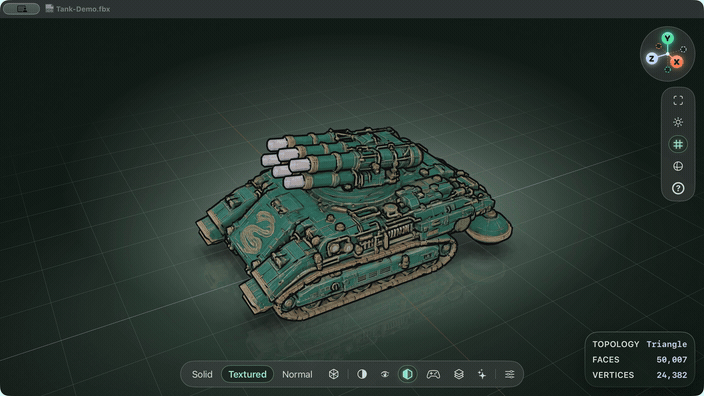

<p align="center">
  
</p>

<h1 align="center">Spacebar 3D</h1>
<p align="center"><strong>你的模型，一键即现。</strong></p>
<p align="center">为 Finder 快速查看和 Mac 打造的原生 3D 查看器。</p>
<p align="center">
  
  
  
  <a href="../../LICENSE"></a>
</p>
<p align="center">
  <a href="#install">开始使用</a> · <a href="#formats">格式</a> · <a href="#controls">操作</a> · <a href="DEVELOPMENT.md">开发指南</a>
</p>
<p align="center"><a href="../../README.md">English</a> · <strong>简体中文</strong> · <a href="../es/README.md">Español</a> · <a href="../fr/README.md">Français</a> · <a href="../de/README.md">Deutsch</a> · <a href="../ja/README.md">日本語</a> · <a href="../pt-BR/README.md">Português do Brasil</a> · <a href="../ko/README.md">한국어</a> · <a href="../it/README.md">Italiano</a> · <a href="../ru/README.md">Русский</a></p>

---

## 找到文件，按下空格，转动模型。

在 Finder 中选中受支持的 3D 文件，按下<kbd>空格键</kbd>，即可旋转模型、检查拓扑、切换外观或浏览动画。也可以在独立应用中打开文件，使用专门的查看窗口。

<p align="center">
  
</p>

> 对于 OBJ、STL、PLY、USD 和 USDZ，macOS 可能会使用自己的预览。通过应用的**文件 → 打开…**，或 Finder 中的**打开方式 → Spacebar 3D**，即可在本查看器中打开受支持的文件。

<a id="looks"></a>

## 一个模型，多种外观

| 检查 | 探索 | 播放 |
| :--- | :--- | :--- |
| 实体、纹理和法线视图；叠加线框；查看面数与顶点数。 | 无明暗、动漫、赛璐璐着色、复古、体素艺术和全息样式；平面或平滑着色；调整材质。 | 选择动画片段、拖动进度和重复播放；支持仅含动画文件的骨架预览。 |

**调整灯光。** 从 Glasshouse 到 Neon，共有七种灯光氛围，可调整亮度、方向，也可让灯光自动旋转。**掌握方位。** 点击方位控件的坐标轴，旋转、平移或缩放以适应窗口，也可以显示地面网格。Finder 的小尺寸预览只显示模型。

**为 Mac 原生打造。** 应用和 Quick Look 扩展共享 Swift、Metal、SwiftUI 与 AppKit 实现。模型在本地处理；两者都没有网络访问授权。界面支持顶部列出的十种语言，并遵循 macOS 的语言偏好。[本地化说明，英文](../LOCALIZATION.md)。

<a id="install"></a>

## 开始使用

**macOS 26 或更新版本 · Apple 芯片 · 从源代码构建**

需要带有 macOS 26 或更新版 SDK 的完整版 Xcode、XcodeGen、CMake 和 Ninja。项目配置了开发签名团队和 App Group。如果使用其他团队，请先按照[签名指南](DEVELOPMENT.md#build-local)配置签名身份及相互匹配的标识符。

在本地仓库目录中运行：

```bash
brew install xcodegen cmake ninja
./scripts/build.sh
```

首次构建会下载并编译固定版本的 Assimp。

1. 将 `build/Build/Products/Release/Spacebar 3D.app` 移到**应用程序**文件夹。
2. **启动应用一次**，让 macOS 注册扩展。
3. 在**系统设置 → 通用 → 登录项与扩展 → 快速查看**中启用 **Spacebar 3D**。
4. 在 Finder 中选中文件，按下<kbd>空格键</kbd>。

如需向他人分发构建，请参阅 [Developer ID 签名与公证指南](DEVELOPMENT.md#distribution-signing--notarization)。

<details>
<summary><strong>将 Spacebar 3D 设为默认查看器</strong></summary>

在应用设置中点按**设为默认…**。macOS 可能会要求确认；应用会报告未能更改的格式。这会影响 Finder 中双击文件的行为，但不会改变 macOS 对 Quick Look 扩展的选择。

</details>

<a id="formats"></a>

## 支持的格式

适用于虚拟形象、游戏资源、CAD 导出文件、扫描模型和 Blender 网格。

`VRM` · `VRMA` · `glTF` · `GLB` · `FBX` · `OBJ` · `STL` · `3MF` · `PLY` · `USD` · `USDA` · `USDC` · `USDZ` · `3DS` · `BLEND`

<details>
<summary><strong>查看各格式的支持范围与限制</strong></summary>

| 格式 | 支持范围 |
| :--- | :--- |
| `.vrm` | VRM 0.x / 1.0 虚拟形象：卡通着色、描边和弹簧骨骼。 |
| `.vrma` | 不含网格的 VRM 动画，以骨架线条人形展示动作。 |
| `.glb` / `.gltf` | glTF 2.0 材质、纹理、蒙皮和动画。外部 `.bin` 与图像需要文件夹访问权限。不支持 Draco、Meshopt 压缩及实例化网格。 |
| `.fbx` | 二进制或文本格式；蒙皮网格和内嵌动画。可读取内嵌图像、同目录图像以及 `.fbm` 文件夹中的图像。 |
| `.obj` | 几何体和顶点颜色；授权文件夹后读取 `.mtl` 材质与纹理。没有面的文件显示为点云。 |
| `.stl` | 二进制或文本 STL。 |
| `.3mf` | 按对象或三角形设置的颜色、图像，以及金属和半透明材质。 |
| `.ply` | 带顶点颜色的网格；没有面时显示为点云。 |
| `.usd` / `.usda` / `.usdc` / `.usdz` | 材质、内嵌纹理和骨骼动画。 |
| `.3ds` | 材质颜色与透明度；授权文件夹后读取外部纹理。 |
| `.blend` | Blender 2.80 及更新版本：保存时的可见网格和基础材质；打包图像及授权文件夹中的纹理。不应用修改器、骨架姿态或动画；不计算任意着色器节点网络。 |

仅含动画且具有受支持骨架的 FBX 和 VRMA 文件会以骨架线条人形显示。应用不附带任何模型或虚拟形象数据。

</details>

### 纹理位于其他文件中时

使用**显示纹理…**、**显示材质…**或**显示模型…**，授予对模型文件夹及其子文件夹的只读访问权限。内嵌纹理不需要文件夹授权，但必须采用受支持的图像和材质格式。在应用中，与模型同名的材质文件，例如 `ship.obj` 旁的 `ship.mtl`，可直接读取，无需询问。

如果模型可以打开，但它引用的纹理都无法绘制，查看器会从**纹理**视图切换到**实体**视图。

<a id="controls"></a>

## 操作指南

| 操作 | 方法 |
| :--- | :--- |
| 旋转 | 拖动；应用的模型画布获得焦点时也可使用方向键 |
| 平移 | 右键拖动，或按住 Shift、Option 或 Command 拖动 |
| 键盘平移 | 应用画布中的 Shift + 方向键，或视图菜单中的平移子菜单 |
| 缩放 | 滚动或双指捏合 |
| 适合窗口 | 点击适合窗口按钮，或在应用中按 ⌘0 |
| 沿坐标轴观察 | 点击方位控件的坐标轴 |
| 播放或暂停 | 点击播放按钮，或在应用画布获得焦点时按空格键 |
| 关闭 Quick Look | 空格键 |
| 实体 / 纹理 / 法线 | 应用中的 ⌘1 / ⌘2 / ⌘3 |
| 切换线框 | 应用中的 ⌘4 |

底部工具栏提供视图、样式和材质设置；右侧包含方位控件、灯光、适合窗口、网格和自动旋转。动画栏支持片段选择和重复播放。应用设置可指定默认背景、实体颜色、视图、亮度、网格、旋转与动画播放行为。画布控件隐藏时，仍可通过视图和播放菜单操作。

<a id="help"></a>

## 遇到问题？

打开查看器工具栏上的 **?** 菜单，即可查看操作说明、隐私政策和致谢。应用和 Quick Look 均提供此菜单。

发现问题或有疑问？在应用中选择 **帮助 → Spacebar 3D 支持**，或直接[提交 issue](https://github.com/vitalis/Spacebar3D/issues)。

<details>
<summary><strong>预览没有出现</strong></summary>

启动应用一次并启用扩展。必要时刷新 Quick Look 缓存：

```bash
qlmanage -r && qlmanage -r cache
```

对于 OBJ、STL、PLY、USD 和 USDZ，请尝试直接在应用中打开。

</details>

<details>
<summary><strong>优先使用 Spacebar 3D，而不是 Apple 的预览</strong></summary>

仓库提供可撤销的可选切换脚本：

```bash
scripts/prefer-spacebar3d.sh status
scripts/prefer-spacebar3d.sh on
scripts/prefer-spacebar3d.sh off
```

`on` 优先使用 Spacebar 3D，`off` 恢复 Apple 的扩展。脚本通过 `pluginkit` 为当前用户停用两个 Apple 预览扩展，不修改系统文件。启用后，MaterialX 和 Alembic 会使用较简单的预览，USDZ 不再提供 AR 视图，`.reality` 将没有预览。macOS 更新可能重置该选择。在应用中打开文件无需执行此切换。

</details>

<details>
<summary><strong>纹理缺失</strong></summary>

通过**显示纹理…**授权模型文件夹。仅在 Quick Look 中授予的权限，在 Mac 重启后需要重新授予。应用会记住自己的授权；重启后启动应用一次，即可再次让 Quick Look 使用这些权限。图像缺失或图像、材质格式不受支持，也可能导致纹理无法显示。

</details>

<a id="architecture"></a>

## 工作原理

应用与扩展共享 `Spacebar3DKit`：`ImportRouter` 将文件读入 `ModelScene`，再由 Metal 绘制。Swift 读取器处理 STL、PLY、OBJ、3MF、glTF、VRM 和 Blender；Model I/O 处理 USD；Assimp 处理 FBX 和 3DS。

[构建与架构](DEVELOPMENT.md) · [本地化](../LOCALIZATION.md) · [更新记录](../../CHANGELOG.md) · [隐私政策（英文）](../../PRIVACY.md)

<a id="credits"></a>

## 致谢与许可证

Spacebar 3D 采用 [Apache 许可证 2.0 版](../../LICENSE)。
Copyright © 2026 Vitaly Gorodetsky。

项目来源、贡献者和致谢见 [CREDITS.md](../../CREDITS.md)；单独授权组件的条款见[第三方许可证](../../THIRD_PARTY_LICENSES.md)。这些声明也可在应用帮助菜单的致谢中查看。
